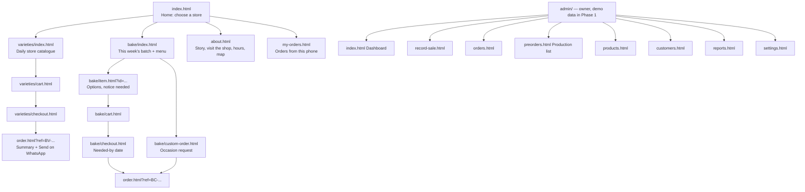
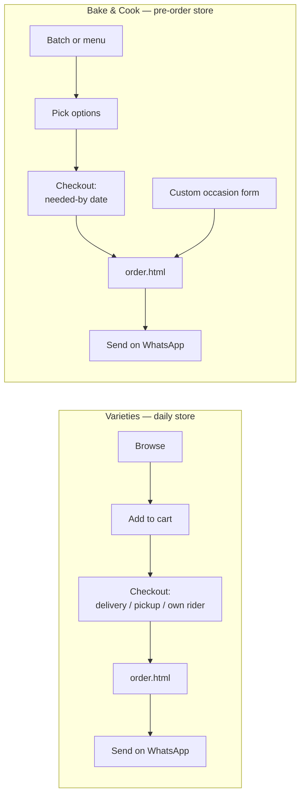

# Bammie — Project Map (Phase 1: HTML / CSS / JS)

One website, **two stores**, one owner dashboard.

| | **Bammie Varieties Store** — the *daily store* | **Bammie Bake & Cook** — the *pre-order store* |
|---|---|---|
| What | Foodstuffs, provisions, stationery, Bammie Chips (plantain, potato, cocoyam, coconut) | Snacks (chin chin, meat pie, small chops), cakes, pastries, meals |
| When | Ready **now**, sold every day, walk-in + online | Made **to order**, always pre-order |
| How it's fulfilled | Delivery by Bammie · customer picks up · customer sends own rider/van | Ready on a **date**: delivery or pickup |
| Order ref | `BV-…` | `BC-…` |
| Theme | Green + gold | Chocolate + gold |

Phase 1 is a **static site on GitHub Pages**. There is no backend yet, so orders are
**sent to Bammie's WhatsApp** as a ready-formatted message. That matches how she takes
orders today. Phase 2 adds a backend: orders are saved, the dashboard becomes real, and
reports run on real data. The frontend is built so that switch only touches **one file**
(`assets/js/api.js`).

---

## 1. What the owner asked for → where it lives

| She said | Feature | Phase |
|---|---|---|
| "Showcase my products" | Two store catalogues, shareable links for WhatsApp status/TikTok | 1 |
| Customers order on WhatsApp/TikTok, then delivery **or** pickup **or** their own van | Varieties checkout with 3 fulfilment options | 1 |
| Bake & Cook is "always on pre-orders"; she posts a batch on her status | **This week's batch** page (order-by cutoff + ready date) | 1 |
| Snacks "for the weekend / for an occasion" | **Occasion / custom order** request form with a needed-by date | 1 |
| No account, but remember my details (developer's promise) | Customer details saved in the browser (`localStorage`) | 1 |
| "How many orders per day from Bake & Cook / Varieties online" | Dashboard: today/week by store and by channel | 1 = demo UI, 2 = real |
| "Record daily activities of the physical store on my phone" | **Record a sale** screen (walk-in, WhatsApp, TikTok, phone call) | 1 = demo UI, 2 = real |
| "End of the year, look back" | Reports + **Year in review** | 2 |
| End-of-season gifts: know who orders more | **Top customers** (customer = phone number) | 2 |
| Visibility, worried people look down on a small shop | Real shop photos, address + map, hours, consistent branding, fast on mobile data | 1 |

---

## 2. Sitemap



### Customer pages

| Page | Purpose | Key parts |
|---|---|---|
| `index.html` | Home — the **two doors** | Brand hero · two big store cards ("Shop everyday needs" / "Pre-order treats") · this week's batch teaser · Bammie Chips strip · how ordering works (3 steps) · visit our shop · WhatsApp + TikTok |
| `varieties/index.html` | Daily store catalogue | Category tabs (Foodstuffs · Provisions · Stationery · Bammie Chips · More) · search · product cards with **qty stepper right on the card**, no product page needed · in-stock badge · sticky cart bar. `?item=<id>` scrolls to and highlights an item, for share links |
| `varieties/cart.html` | Varieties cart | Lines, qty edit, subtotal, "delivery fee confirmed on WhatsApp" or zone fee |
| `varieties/checkout.html` | Details + fulfilment | Name, phone (WhatsApp), **Delivery / I'll pick up / I'll send my rider**, address + area (delivery only), preferred time, payment (transfer / pay on pickup / pay on delivery), note. Pre-filled from remembered details |
| `bake/index.html` | Pre-order store | **This week's batch** card (order-by countdown, ready date, limited items) · full menu by category · each item shows "from ₦X" and **"needs N days' notice"** · "Planning an occasion?" banner → custom order |
| `bake/item.html?id=` | Bake item detail | Photos, pack/size/flavour options, min quantity, earliest date |
| `bake/cart.html` | Pre-order tray | Lines + options |
| `bake/checkout.html` | Pre-order details | **Needed-by date + time** (date picker blocks days earlier than the longest lead time in the tray), occasion, delivery/pickup, deposit note, cake message |
| `bake/custom-order.html` | Occasion request | Event date, event type, number of guests, what they want (checkboxes + free text), budget range, notes → sends a `BC-` request, not a priced order |
| `order.html?ref=` | Confirmation (shared) | Ref, items, total, fulfilment, bank-transfer details, **big "Send order to Bammie on WhatsApp" button** + "your order is not sent until you tap this" |
| `my-orders.html` | Orders placed from this phone | Filter by store · "Send on WhatsApp" for unsent orders · "Order again" (today's prices; unavailable items named; batch items come back as menu items) · clear the list · Phase 2: live status by ref + phone |
| `about.html` | Trust + visibility | How Bammie works (from her voice notes; her own story still to add) · our promise (the flyer's tagline) · visit/call block · flyer badge. Shop photos and a map link when she sends them |
| `404.html` | GitHub Pages not-found | Sets `<base>` to the site root first, so it works at any missing address (e.g. `/bammie/old/link`) · links to both stores and home |

### Owner pages (`admin/`)

Phase 1 builds these as a **clickable prototype with clearly fake demo data**. They have a
"DEMO" banner, `noindex`, are blocked in `robots.txt`, and are not linked from the public
site. Real login and real data come with the backend, because a GitHub Pages site **cannot
keep a secret**.

**Built (Phase 1, step 6)** — phone-first with a bottom tab bar; "Add to home screen" via
`admin/manifest.webmanifest`:

| Page | Purpose |
|---|---|
| `index.html` | **Today so far** vs the same day last week by this time · split **Varieties in the shop / Varieties online / Bake & Cook** · last-7-days chart · pre-orders due today and tomorrow · latest sales |
| `record-sale.html` | Tap products → check total → save. Cash and walk-in preselected, so a common sale is **2 taps**. Payment (cash / transfer / POS), channel (walk-in / WhatsApp / TikTok / call), optional phone (recognises regulars). Bake & Cook with a "needed on" date = pre-order on the production list |
| `preorders.html` | **Production list**: next 7 days, one card per day: what to make (totals per item and pack), then each order with slot, payment, delivery/pickup, cake message and a **Ready** tick · print |
| `reports.html` | Filters (this week / month / 30 days / year × store) scope everything: totals vs the previous period, sales over time, channels, top products, **top customers** (copy gift list), **year in review**, CSV download |

**Demo data:** generated in the browser by `assets/js/admin/demo-data.js` from the real
catalogues: two years of orders, the same each time for a given day, with made-up names
and `0000` phone numbers. Sales recorded on the phone are added on top
(`bammie.demo.sales`); "Reset demo" clears them. Everything goes through `api.js`
(`getAdminOrders`, `recordSale`, `setOrderReady`), so Phase 2 swaps in the real backend.

**Chart colours:** green `#2A7A45` (Varieties) and gold `#D9A21B` (Bake & Cook), checked with
the colour-blindness validator. Brand brown fails that check against green. Every chart has a
legend, keyboard-reachable tooltips and a "Show as table" view.

**Phase 2, with the backend** (they need real data or a login): `login.html`, `orders.html`
(all orders, change status), `products.html` (prices, stock, photos, weekly batch),
`customers.html` (full customer list), `settings.html` (business info, delivery fees, bank
details, deposit, time slots).

---

## 3. Order flows



**Status flows** (Phase 2, but the data model carries them from day one):

- Varieties: `new → packed → out-for-delivery | ready-for-pickup → completed` (or `cancelled`)
- Bake & Cook: `requested → confirmed (deposit paid) → preparing → ready → completed` (or `cancelled`)

**WhatsApp message** (built by `orders.js`, sent via `https://wa.me/234XXXXXXXXXX?text=…`):

```
Hello Bammie! New order BV-261027-4F7K
Store: Varieties Store
• 2 × Mama Gold Rice 5kg — ₦19,000
• 1 × Plantain Chips (big) — ₦1,500
Subtotal: ₦20,500
Fulfilment: I'll send my rider
Name: Ada Okafor · 0803 000 0000
Note: Please pack the chips separately
```

---

## 4. Folder structure

```
BammieV/
├── index.html
├── about.html
├── order.html
├── my-orders.html
├── 404.html
├── varieties/
│   ├── index.html
│   ├── cart.html
│   └── checkout.html
├── bake/
│   ├── index.html
│   ├── item.html
│   ├── custom-order.html
│   ├── cart.html
│   └── checkout.html
├── admin/                      # prototype, demo data only in Phase 1
│   ├── index.html  record-sale.html  preorders.html  reports.html
│   └── manifest.webmanifest    # "Add to home screen" for the owner's phone
├── assets/
│   ├── css/
│   │   ├── tokens.css          # colours, fonts, spacing, radii; .theme-varieties / .theme-bake
│   │   ├── base.css            # reset, typography, utilities
│   │   ├── layout.css          # header + store switcher, footer, grids
│   │   ├── components.css      # buttons, cards, qty stepper, forms, badges, toasts, cart bar
│   │   ├── store.css           # catalogue, batch card, checkout, order page
│   │   └── admin.css
│   ├── js/
│   │   ├── config.js           # business info, WhatsApp number, bank details, PREVIEW, API_BASE = null
│   │   ├── storage.js          # localStorage wrapper that never throws (private mode, full storage)
│   │   ├── lines.js            # cart lines → names, prices, availability, batch/notice rules
│   │   ├── dates.js            # local calendar dates (never UTC), Nigerian-style formatting
│   │   ├── form.js             # inline form errors shared by the checkouts and occasion form
│   │   ├── cart-bar.js         # sticky "n items · ₦total" bar
│   │   ├── bake-form.js        # time-slot, occasion and "what would you like" choices
│   │   ├── api.js              # THE seam: reads /data/*.json now, calls the backend in Phase 2
│   │   ├── cart.js             # two carts: bammie.cart.varieties / bammie.cart.bake
│   │   ├── customer.js         # remembered details: name, phone, address, area, fulfilment
│   │   ├── orders.js           # ref generator, local order history, WhatsApp message builder
│   │   ├── ui.js               # header, cart badges, toasts, ₦ formatting, date helpers
│   │   ├── pages/              # one small module per page (home.js, varieties.js, bake.js, …)
│   │   └── admin/              # demo-data.js, stats.js, chart.js, admin-ui.js + one script per page
│   └── img/
│       ├── brand/              # logo SVGs, favicon, social share image
│       ├── shop/               # real shop photos
│       └── products/           # WebP, ~600px, named by product id
├── data/
│   ├── varieties-products.json
│   ├── bake-menu.json
│   ├── bake-batch.json         # this week's batch
│   ├── delivery-zones.json
├── robots.txt                  # Disallow: /admin/
├── .nojekyll
├── .gitignore                  # ignores _private/
├── PROJECT_MAP.md
└── README.md
```

No framework and no build step: plain HTML, CSS and ES modules (`<script type="module">`).
That keeps it fast on mobile data and deploys straight to GitHub Pages.

---

## 5. Data shapes: the contract the backend must honour later

Money is **whole naira as integers** (`9500`, not `"₦9,500"`). Customers are identified by
**phone number normalised to `234…`**.

```jsonc
// data/varieties-products.json
{ "id": "mama-gold-rice-5kg", "store": "varieties", "name": "Mama Gold Rice 5kg",
  "category": "foodstuffs", "price": 9500, "unit": "bag",
  "image": "assets/img/products/mama-gold-rice-5kg.webp", "inStock": true, "featured": false }

// data/bake-menu.json: every item has at least one option, and the price lives on the option
{ "id": "meat-pie", "store": "bake", "name": "Meat Pie", "category": "pastries",
  "blurb": "Buttery pastry filled with minced meat…",
  "options": [{ "id": "pack-6", "label": "Pack of 6", "price": 4200 }],
  "leadTimeDays": 2,        // days' notice; earliest date = today + leadTimeDays
  "minQty": 1,              // e.g. 10 for small chops packs
  "messageAllowed": false,  // true on cakes → "Message on the cake" at checkout
  "image": null, "available": true }

// data/bake-batch.json: this week's batch, what she posts on her WhatsApp status
{ "id": "2026-w44", "title": "Weekend batch", "blurb": "…",
  "orderBy": "2026-10-29T18:00:00+01:00", "readyOn": "2026-10-31",
  "items": [{ "itemId": "chin-chin", "option": "small", "limit": 40 }] }
//   open until orderBy; hidden once readyOn has passed; items: [] = no batch this week.
//   limit is shown and capped per order; Phase 2 counts it down across orders.

// an order (saved locally in Phase 1, sent to the API in Phase 2)
{ "ref": "BC-261027-4F7K", "type": "order", "store": "bake",   // type: order | request
  "channel": "website",                 // website | walk-in | whatsapp | tiktok | call
  "createdAt": "2026-10-27T19:04:00+01:00",
  "customer": { "name": "…", "phone": "234…", "address": "…", "area": "…" },
  "items": [{ "id": "meat-pie", "name": "Meat Pie", "unit": "Pack of 6", "option": "pack-6",
              "batch": "2026-w44", "price": 4200, "qty": 2 }],   // option/batch: Bake only
  "subtotal": 8400,
  "deliveryFee": null,                  // null = to be agreed on WhatsApp; a number once set
  "total": 8400,
  "deposit": null,                      // set when BAKE.depositPercent is configured
  "fulfilment": "pickup",               // delivery | pickup | own-rider (own-rider: Varieties only)
  "preferredTime": "Today by 5pm",      // Varieties: free text, optional
  "neededBy": "2026-10-31",             // Bake: one date for the whole pre-order
  "timeSlot": "afternoon",              // Bake: morning | afternoon | evening (config.js BAKE.timeSlots)
  "occasion": "Birthday",               // Bake, optional
  "cakeMessage": "Happy 30th, Ada!",    // Bake, only when a cake is in the order
  "payment": { "method": "transfer", "status": "unpaid" },   // null on requests
  //   method — website: transfer | pay-on-collection | pay-on-delivery
  //            walk-in (Phase 2): cash | pos | transfer
  //   status — unpaid | deposit | paid
  "status": "requested", "note": null,
  "sentAt": "2026-10-27T19:05:00Z" }    // Phase 1 only: when the customer tapped "Send on WhatsApp"

// an occasion request (bake/custom-order.html): same shape, no items or prices yet
{ "ref": "BC-…", "type": "request", "store": "bake", "items": [], "subtotal": null, "total": null,
  "neededBy": "2026-11-14", "timeSlot": "morning", "occasion": "Naming ceremony",
  "request": { "eventType": "Naming ceremony", "guests": 60, "wants": ["Small chops", "Celebration cake"],
               "budget": "₦100,000 – ₦250,000", "details": "Blue and white theme" },
  "payment": null, "status": "requested", … }
```

A catalogue file is `{ "categories": [{ id, name, blurb, icon }], "products": [...] }`;
`icon` names the placeholder drawn until a product has a photo.

`localStorage` keys: `bammie.customer` (shared by both stores), `bammie.cart.varieties`,
`bammie.cart.bake`, `bammie.orders` (the last 50 orders placed from this phone). Cart lines
are `{ id, qty }`, plus `option` and `batch` for Bake. Names, prices and availability are
always read from the live catalogue (`assets/js/lines.js`).

---

## 6. Design system (from the flyer)

| Token | Value (starting point) | Use |
|---|---|---|
| `--green-900` | `#0F3D22` | Headings, footer |
| `--green-700` | `#1E5631` | Varieties primary |
| `--gold-500` | `#E9B21C` | Accents, highlights, crown |
| `--brown-800` | `#5A2A17` | Bake & Cook primary |
| `--cream-50` | `#FFF8E9` | Page background |
| `--ink` | `#1E1E1E` | Body text |

- **Fonts (2 only, to save data):** a script face for the *Bammie* wordmark only
  (candidate: Kaushan Script) + **Poppins** for everything else.
- **Each store has its own theme:** `<body class="theme-varieties">` or `theme-bake`
  swaps the primary colour, so customers always know which store they are in.
- **Header** on every shop page: Bammie wordmark · **store switcher pill**
  (Varieties | Bake & Cook) · that store's cart icon with count · WhatsApp button.
- **Logo:** the current image is a **flyer/badge, not a logo** (agreed). Phase 1 ships a
  simple SVG wordmark placeholder: "Bammie" in script with the small gold crown, plus two
  lockups (· Varieties Store in green, · Bake & Cook in brown) and a round "B" favicon. It
  gets swapped when she supplies or approves a real logo. The flyer can still be used on
  About.
- Mobile-first (most visitors come from WhatsApp/TikTok on Android), large tap targets,
  WebP images with `loading="lazy"`.

---

## 7. Build order (what we cook first)

1. ✅ **Foundation**: `tokens.css`, `base.css`, `components.css`, header/footer, placeholder logo, `config.js`, `ui.js`
2. ✅ **Home**: the two doors
3. ✅ **Varieties**: catalogue → cart → checkout → `order.html` → WhatsApp, with remembered details
   (sample catalogue in `data/varieties-products.json`)
4. ✅ **Bake & Cook**: menu + batch → item → pre-order checkout (date rules) → custom order
   (sample menu and batch in `data/bake-menu.json` and `data/bake-batch.json`)
5. ✅ **My orders, About, 404** (footer gained a "Bammie" column: About us, Visit the shop, My orders)
6. ✅ **Admin prototype**: dashboard, record sale, production list, reports (demo data)
7. **Deploy** to GitHub Pages, then test on a real Android phone on mobile data

**Phase 1 is done when:** an order placed on a phone lands in Bammie's WhatsApp correctly
formatted, from both stores · returning visitors see their details pre-filled · every page
works at 360px wide · no page loads more than ~500 KB on first visit · the owner can click
through the admin prototype and say "yes, this is what I want".

---

## 8. Deployment (GitHub Pages)

- `git init` **inside `BammieV/`**. A stray repo exists at `C:\`, so without this, commits
  go to the wrong place.
- Use **relative paths everywhere** (`assets/css/…`, `../assets/css/…`), never `/assets/…`.
  A project site lives at `username.github.io/bammie/`, so root-absolute paths break.
- `.nojekyll` at the root so GitHub serves files as-is.
- Pages → *Deploy from branch* → `main` / root.
- Local preview needs a server, because `fetch()` of JSON fails on `file://`:
  `python -m http.server 5500` from the project folder.
- **The repo is public:** no real customer data, no passwords, no API keys. Demo data only.
  `_private/` is git-ignored.
- Later: custom domain (e.g. `bammie.com.ng`) via a `CNAME` file.

---

## 9. Phase 2 (backend) — the shape, not the build

- Backend as a **JSON API** (Laravel + MySQL fits the stack we already use). The static
  frontend stays on GitHub Pages or moves to the same host, and only `api.js` changes.
- Orders saved server-side at checkout; WhatsApp becomes a notification, not the record.
- Admin login, real dashboard, **Record a sale** writing to the same orders table
  (`channel: walk-in`), stock toggles, batch limits that actually count down.
- Reports, **year in review**, **top customers**, CSV export.
- Optional: Paystack for online payment and deposits, SMS or WhatsApp status updates
  to customers.

---

## 10. Waiting on Bammie (content checklist)

- [ ] Which line is **WhatsApp Business**: 0915 526 9214 (Glo) or 0810 821 2867 (MTN)?
- [ ] Shop **address**, area/city, **opening hours**, **email**, **TikTok handle**
- [ ] **Delivery**: areas covered and fees (fixed per zone, or "confirmed on WhatsApp")
- [ ] **Payment**: bank account for transfers? pay on delivery/pickup allowed? **deposit** % for pre-orders?
- [ ] **Bake & Cook menu**: items, pack sizes, prices, **days' notice** per item, minimum quantity
- [ ] **Pre-order times**: are morning / afternoon / evening slots right? Days she doesn't bake (e.g. Sunday)?
- [ ] **Occasions**: how many days' notice for events (sample uses 3)? Deposit % to secure a date?
- [ ] **Weekly batch**: does she want to keep posting it here each week (edit `data/bake-batch.json` until the admin exists)?
- [ ] **Bammie Chips**: ready stock (daily store) or made to order? Pack sizes and prices
- [ ] **Varieties list**: start with her top 30–50 sellers, not the whole shop
- [ ] Stock: is "in stock / out of stock" enough for now? (recommended for v1)
- [ ] **Photos**: shop front, inside the shop, products, her baking
- [ ] **Logo**: will she design one, or should we?

## 11. Decisions taken in this map (change them here if you disagree)

1. **Two separate carts and checkouts**, shared code. Fulfilment, dates and reports differ
   per store, and she wants the numbers per store. A mixed order becomes two refs.
2. **WhatsApp checkout in Phase 1**, so the site is useful from day one.
3. **Bake & Cook has two modes**: weekly batch (what she posts on her status) and
   occasion/custom orders.
4. **Every sale carries a channel tag** (website, walk-in, WhatsApp, TikTok, call). That is
   how the dashboard answers "how much came from where".
5. **Phone number = customer ID.** No accounts, but loyalty and top customers still work.
6. **Admin is demo-only until the backend exists.** A public static site cannot protect
   real business data.
7. **No product page for Varieties items.** Qty stepper on the card is faster for groceries;
   Bake items get a detail page because they have options and dates.
8. **One date per pre-order.** The earliest date comes from the item needing the most notice.
   Batch items fix the date to the batch's ready day; if a menu item can't be ready by then,
   checkout says which one and blocks the order until it's split.
9. **Bake & Cook payment is bank transfer after Bammie confirms.** No pay-on-delivery for
   pre-orders, since she buys ingredients up front. A deposit % turns on in `config.js`.
